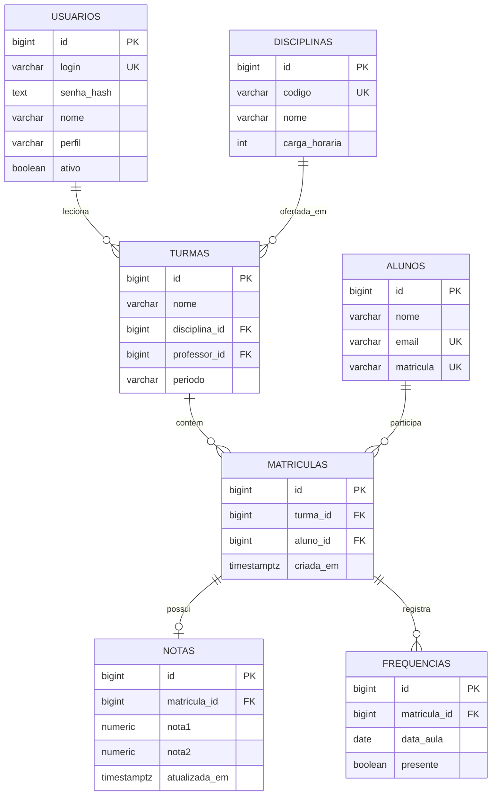

# Modelagem do banco G10

## Diagrama entidade-relacionamento

## Schemas

**`app`** concentra dados operacionais e cálculos: `usuarios`, `alunos`, `disciplinas`, `turmas`, `matriculas`, `notas` e `frequencias`.

**`audit`** concentra logs de rastreabilidade: `log_eventos`, com coluna `dados_antes` JSONB e `dados_depois` JSONB.

## Regras de negócio

- Um professor leciona várias turmas; cada turma está vinculada a um único professor e uma disciplina.
- Um aluno pode cursar várias turmas; a matrícula resolve essa relação muitos-para-muitos com chave única `(turma_id, aluno_id)`.
- Cada matrícula tem até um registro de notas, com notas individuais de 0 a 10.
- Cada matrícula tem várias frequências, mas só uma por `(matricula_id, data_aula)`.
- A **situação acadêmica** é calculada pela função com as regras didáticas: média >= 6 e presença >= 75%.
- Somente `usr_coordenador` pode alterar tabelas de cadastro (alunos, disciplinas, turmas, matrículas).
- O professor pode lançar notas e frequências apenas dos alunos de suas turmas; quem aplica a restrição por linha é o PostgreSQL.
- Toda alteração de notas e frequências gera auditoria automática e vinculada ao ID do operador.

## Exemplo dos dados iniciais

| Matrícula ID | Aluno | Turma | Professor | O que prova |
|---|---|---|---|---|
| 1 | Maria Souza | BD - Noturno | Ana | Ana pode ver/editar |
| 2 | João Martins | BD - Noturno | Ana | Ana pode ver/editar |
| 3 | Maria Souza | Algoritmos - Vespertino | Bruno | Ana não pode ver/editar |
| 4 | Carla Lima | Algoritmos - Vespertino | Bruno | Bruno pode ver/editar |
| 5 | Carla Lima | Engenharia - Noturno | Ana | Ana pode ver/editar |

**Resultado esperado do teste de RLS:** Ana = 3 linhas, Bruno = 2 linhas, coordenação = 5 linhas.
